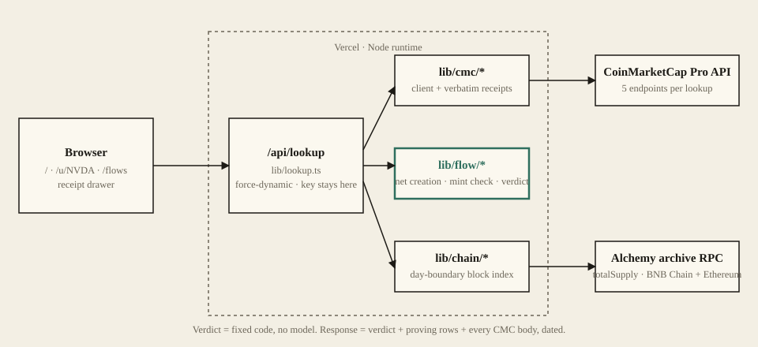

<div align="center">
  
  <h1>NetMint ⚖️</h1>
  <p><em>CoinMarketCap records every tokenised stock's supply but never shows the money behind it: NVDAB's supply went ×7.1 in 30 days, +$202.83M of net creation, and the chain confirms it.</em></p>
  

  <br/>

  [](https://netmint.edycu.dev)
  [](https://dorahacks.io/hackathon/coinmarketcap-api-202611/detail)

  <br/>

  
  
  
  [](https://opensource.org/licenses/MIT)

</div>

---

> **Window and date.** Every figure below is NVDAB (bStocks) over 2026-10-22 → 2026-11-21 (30 days), captured 2026-11-21 in
> [`evidence/2026-11-21/nvda-30d/`](evidence/2026-11-21/nvda-30d/). The window sat inside a market stress period (price −41%), so
> read the ×7.1 as a measurement of that window, not a trend. "×7.1" is CMC's supply ratio; the chain's own ratio is 7.42. +$202.83M is `net_usd` 202826522.82 in `table.json`.

## 📸 See it in Action

<p align="center"></p>

No wallet needed anywhere: every page is a read-only call. Open <https://netmint.edycu.dev>, type a ticker, and the page runs the
whole flow behind that click and shows each CMC response verbatim in a receipt drawer.

## 💡 The Problem & Solution

### The Problem
CMC lists tokenised stocks with a daily circulating supply. That supply is the only public trace of primary-market creation and
redemption (issuers mint on creation and burn on redemption), yet CMC does not show it the way an ETF flow table shows creations.
A holder sees prices that move together and supplies that move apart, and nothing joins the two. A supply jump can also be a
data artefact, a listing change, or a move on a chain nobody reads.

### The Solution
NetMint turns CMC's daily supply history into **net creation and redemption in USD per wrapper** (Δsupply × price) and puts every
supply step it relies on **on trial against the chain**: the day's CMC move must match the on-chain `totalSupply` step within
±10%, and a sampled mint is traced to its transaction. Then it stamps one verdict:

| Verdict | Meaning |
|---|---|
| **REAL INFLOW** / **OUTFLOW** | verified net creation / redemption at issuer level. Not buyer data. |
| **RECOUNT** | CMC's supply moved and the chain did not |
| **NOT VERIFIABLE** | the move may sit on a chain NetMint cannot read (Solana, Arbitrum, Base, Robinhood Chain, X Layer), or the check cannot certify it |
| **FLAT** | below the materiality threshold; not put to trial |

The verdict is computed by fixed code ([`lib/flow/verdict.ts`](lib/flow/verdict.ts)); no model decides it. No wording in the app
is investment advice.

**The headline case, measured:** NVDAB's CMC supply rose +1,209,739 units; the chain's `totalSupply` rose +1,216,792 (+0.6%
apart, tolerance ±10%). The 5 largest step days (3-day sums) all matched within remedy. For each of 7 step days we sampled the one mint at the block where on-chain supply
crossed that day's halfway point; all 7 went to a single recipient, `0x5948…adad1`. The sampled 2026-11-13 mint (`0xa239f888…15266c`, 640 units) is
0.16% of that day's on-chain step, so it shows who receives mints, not how big the creation was; a single recipient is consistent with issuer-level creation rather than retail buying.

## 🏗️ Architecture & Tech Stack

<p align="center"></p>

| Layer | Choice |
|---|---|
| App | Next.js (App Router) + TypeScript on Vercel; one route handler, `/api/lookup`, runs the flow |
| Sponsor data | CoinMarketCap Pro API, key server-side only (the key never reaches a response) |
| Chain check | Alchemy archive JSON-RPC, `eth_call totalSupply` at day-boundary blocks on BNB Smart Chain + Ethereum; committed daily baseline in `data/chain-supply/` |
| Tests | Vitest, 201 tests in 8 files |
| Routes | `/` hero · `/u/<ticker>` lookup · `/flows` leaderboard · `/api/lookup` · `/api/holders` · `/api/health` |

## 🏆 CoinMarketCap Integration

Seven CMC endpoints are called live, with credits counted per lookup (`npm run demo -- NVDA` = 5 calls, 7 credits, 1.8 s).
Verbatim bodies for every call are committed in [`docs/proof/spike/`](docs/proof/spike/) and
[`evidence/2026-11-21/nvda-30d/`](evidence/2026-11-21/nvda-30d/); the same bodies appear in the app's receipt drawer.

| # | Endpoint | Used for | Code |
|---|---|---|---|
| 1 | `GET /v5/real-world-assets/assets/list` | the universe: underlyings → `rwa_id` | [`lib/cmc/rwa.ts`](lib/cmc/rwa.ts) |
| 2 | `GET /v5/real-world-assets/quotes/latest?rwa_id=` | every wrapper of one stock: crypto id, issuer, price | [`lib/cmc/rwa.ts`](lib/cmc/rwa.ts) |
| 3 | `GET /v2/cryptocurrency/quotes/historical?interval=daily` | the daily supply, price and volume series: the engine | [`lib/cmc/history.ts`](lib/cmc/history.ts) |
| 4 | `GET /v2/cryptocurrency/info` | contract addresses per chain, for the mint check | [`lib/cmc/info.ts`](lib/cmc/info.ts) |
| 5 | `GET /v2/cryptocurrency/quotes/latest` | today's point (shown apart, never in the window) + volume | [`lib/cmc/quotes.ts`](lib/cmc/quotes.ts) |
| 6 | `GET /v1/dex/holders/count` | holder count per chain (holder panel) | [`lib/cmc/holders.ts`](lib/cmc/holders.ts) |
| 7 | `GET /v1/key/info` | plan and credits for `/api/health` | [`lib/cmc/key.ts`](lib/cmc/key.ts) |

**Code and response, side by side** (from `npm run demo -- NVDA`, fetched 2026-11-21T01:40Z, `evidence/2026-11-21/nvda-30d/table.json`):

```text
REAL INFLOW     NVDAB    bStocks   +$202.83M  units ×7.13  price −41.0%  cov 96.1%
                window endpoints and the 5 largest steps (68% of gross flow, capped at 5 days) verified
                (chain +1,216,792 · CMC +1,209,739 · +0.6% · within remedy ±10%)
  step 2026-11-13: CMC 3d 522,505 · chain 3d 535,910 · ok
  mint tx 0xa239f8886f2b7a4a61daa2787b0b53e58715c2c0dcd8d8f4ef84c8dfea15266c → 0x5948…adad1
NOT VERIFIABLE  NVDAX    Backed Assets  cov 14.5%  86% of supply sits outside BNB Chain + Ethereum (Solana), ...   (excerpt)
```

### What the API made possible
`quotes/historical` back-fills daily circulating supply for every tokenised wrapper, and `v5/real-world-assets` ties wrappers to
one underlying stock. Together they make a cross-issuer flow table possible without scraping each issuer's site (12 issuers in the top-20 universe). The `/flows`
page ranks the top 20 underlyings (152 wrappers): over 30 days the checks verified 6 REAL INFLOW + 3 OUTFLOW, flagged 12
RECOUNT, and returned NOT VERIFIABLE for 107, mostly wrappers whose supply sits on chains with no historical supply source
([`evidence/2026-11-21/flows-30d.json`](evidence/2026-11-21/flows-30d.json), 129 credits).

### Where it got in the way
- `quotes/historical` with `convert=<fiat>` multiplies `circulating_supply` by the exchange rate and scales `percent_change_24h`
  the same way, while `quotes/latest` with `convert=IDR` is correct. NetMint always asks in USD
  ([`docs/proof/spike/convert-bug/`](docs/proof/spike/convert-bug/)).
- The same ticker can map to several ids (`NVDA` maps to 2), so every join is by `crypto_id` / `rwa_id`, never by symbol.
- `POST /v1/dex/holders/list` returned 400 for three POST shapes and 405 for a GET (four attempts kept in
  [`docs/proof/spike/`](docs/proof/spike/)), so the holder panel uses the count endpoint only.
- Plan limits are real: CMC's pricing page lists daily `quotes/historical` for Basic at one year of depth ([`basic-tier.json`](docs/proof/spike/basic-tier.json));
  we could not test a Basic key. The one plan error we observed (1006, on `/v1/blockchain/statistics/latest`) is in
  [`plan-errors.json`](docs/proof/spike/plan-errors.json). Our event key (2M credits/month, 750 req/min per `/v1/key/info`) reverts to the free Basic tier when submissions close (9 Dec 23:59 UTC), so after that the click falls back to `mode: "live-stored"`: stored dated CMC bodies plus live chain reads, labelled
  as such in the receipts. A window outside the stored bodies then shows the verbatim plan error, not a guess.
- The daily point closes at 00:00 UTC, so one day offset is fixed per issuer from the step alignment; ambiguous alignment
  yields NOT VERIFIABLE, never RECOUNT.

## ⛓️ Live Deployment

Read-only on-chain calls, no wallet and no transactions from us. Proof the chain side is real:

- Live app: <https://netmint.edycu.dev> (health: [`/api/health`](https://netmint.edycu.dev/api/health))
- NVDAB mint transaction on BNB Smart Chain: `0xa239f8886f2b7a4a61daa2787b0b53e58715c2c0dcd8d8f4ef84c8dfea15266c`
  ([`docs/proof/mints/nvdab-bsc.json`](docs/proof/mints/nvdab-bsc.json))
- Block-boundary check of the day index: [`docs/proof/spike/chain-boundary.json`](docs/proof/spike/chain-boundary.json)

## 📊 Engineering Rigor

| Metric | Value |
|---|---|
| Tests | 201 passing, 8 files (`npm test`) |
| Offline check | `npm run verify:offline` runs the demo with the network blocked and passes only if it fails and prints no verdict |
| Stored-evidence replay | `npm run verify:flows`: 304 leaderboard rows re-derived from the stored bodies, 0 diffs |
| Secrets | gitleaks clean on full history at HEAD (`gitleaks detect --log-opts=--all`, 2026-11-21) |

### Invariants (stated and tested)
1. **No direction without a mint check.** REAL INFLOW or OUTFLOW requires a passing chain check.
2. **No verdict on error.** A CMC error for a wrapper yields an error row, never a verdict (one stated exception: `live-stored`).
3. **No silent drop.** `accepted + refused = raw` for every series.
4. **Key never leaves the server.** A test sets a canary key and asserts it never appears in serialized output.
5. **Keyed by id.** Symbol is display only.
6. **Window honesty.** Every number carries its window and capture time.

Latency and p50/p95 for the live path are not published yet; they land with the benchmark script.

## 🚀 Getting Started

### Prerequisites
Node 22, a CMC Pro API key, an Alchemy key for BNB Smart Chain and Ethereum archive reads (only for refreshing the baseline).

### Installation
```bash
npm ci
export CMC_API_KEY=...        # server-side only
npm run demo -- NVDA          # the full flow in the terminal, 7 credits
npm run dev                   # the app at http://localhost:3000
```

## 🧪 Testing & CI

```bash
npm test                      # 201 tests
npm run typecheck
npm run verify:offline        # unplug the network: the demo must fail, not print a verdict
npm run verify:flows          # recompute /flows from the stored bodies, expect 0 diffs
npm run snapshot -- NVDA --window 30   # write a dated evidence folder
```

A GitHub Actions workflow ([`.github/workflows/ci.yml`](.github/workflows/ci.yml)) is in the repo; Its runs have not started
(GitHub billing/spending-limit error on the account), so no CI badge is shown; the commands above are the gate.

## 📁 Project Structure

```text
app/            pages (/, /u/[ticker], /flows) and routes (api/lookup, api/holders, api/health)
lib/cmc/        CMC client + verbatim receipts, one file per endpoint family
lib/chain/      archive RPC, day-boundary block index, supply reads
lib/flow/       sanity guard, net creation, mint check, verdict
data/           committed block index + daily on-chain supply baseline
evidence/       dated snapshots: verbatim CMC bodies + computed table
docs/proof/     raw spike, calibration and mint proofs
scripts/        demo, snapshot, flows, verification
tests/          Vitest suites
```

## 🗺️ Roadmap

- [x] Net creation per wrapper from CMC supply history
- [x] Chain check on BNB Smart Chain + Ethereum, mint traced to a transaction
- [x] Leaderboard of the top 20 tokenised stocks
- [ ] Solana, Arbitrum, Base, Robinhood Chain and X Layer supply sources (those wrappers stay NOT VERIFIABLE)
- [ ] Benchmark script with p50/p95

## 📽️ Demo Materials

Live: <https://netmint.edycu.dev> · Walkthrough with the exact click path and commands: [DEMO.md](DEMO.md).

## 🧾 Pre-existing work and what is new

Everything in this repository was written for this hackathon: the first commit is dated 2026-11-21 (the empty GitHub repository was created on 2026-11-20 UTC) and no code, HTML or assets
come from any earlier CMC-hackathon repository. Third-party code is limited to npm dependencies in `package-lock.json`.
The visual identity (`docs/assets/`) was generated for NetMint during the event.

## 🙈 What we got wrong

1. **We first called supply growth "inflow from holders".** Every sampled mint is a Transfer from the zero address, so a minter executed it, and all 7 NVDAB mints we sampled
   (one per step day) went to one address. It is issuer-level creation, so the wording is now "net creation", counted like an ETF flow.
2. **We nearly called NVDAX's July–August fall a real redemption.** Most of it was one day, 2026-07-31, when at least 4 Backed/xStocks
   wrappers (NVDAX, AAPLX, INTCX, MUx) dropped together: a CMC circulating/total split, not a redemption. `docs/proof/calibration/history-baseline.json` holds the series. Every figure now carries its window, and
   unverified moves get NOT VERIFIABLE. (Observed during development; not part of the committed evidence.)
3. **One chain showed 44% of NVDAon's CMC supply.** CMC's figure is the sum over chains, so the check sums legs too.
4. **The hero scale note was wrong on first draft.** "Supply ×7.1" is CMC's ratio; the chain's own ratio is 7.42 and the start
   value read 3.9% lower. The page and this README say "CMC supply ×7.1".
5. **Dollars are net creation at market price, not money that changed hands.** Every dollar caption says "at market price".

## 📄 License

MIT. See [LICENSE](LICENSE).
