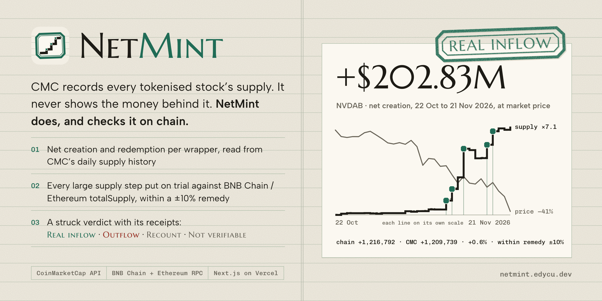

<div align="center">
  
  <h1>NetMint ⚖️</h1>
  <p><em>For a holder of a tokenised stock, a supply jump on CoinMarketCap can be new tokens or a data change. NetMint turns CMC's daily supply history into net creation and redemption per wrapper, in dollars at market price, and checks the jump on chain: NVDAB's CMC supply went ×7.1 in 30 days while the price fell 41%, +$202.83M of net creation at market price, confirmed on BNB Chain.</em></p>
  

  <br/>

  [](https://netmint.edycu.dev)
  [](https://netmint.edycu.dev/judge)
  [](https://netmint.edycu.dev/about)
  [](https://netmint.edycu.dev/pitch)
  [](https://dorahacks.io/hackathon/coinmarketcap-api-202611/detail)

  <br/>

  
  
  
  [](https://github.com/edycutjong/netmint/actions/workflows/ci.yml)
  [](https://opensource.org/licenses/MIT)

</div>

---

> **Window and date.** Every figure below is NVDAB (bStocks) over 2026-10-22 → 2026-11-21 (30 days), captured 2026-11-21 in
> [`evidence/2026-11-21/nvda-30d/`](evidence/2026-11-21/nvda-30d/). The window sat inside a market stress period (price −41%), so
> read the ×7.1 as a measurement of that window, not a trend. The app's hero replays the newest stored copy of the same request
> (02:51 UTC, [`evidence/2026-11-21/flows/nvda-30d/`](evidence/2026-11-21/flows/nvda-30d/)), which gives the same `net_usd`. "×7.1" is CMC's supply ratio; the chain's own ratio is 7.42. +$202.83M is `net_usd` 202826522.82 in `table.json`.

## 📸 See it in Action

<p align="center"></p>

No wallet needed anywhere: every page is a read-only call. Open <https://netmint.edycu.dev>, type a ticker, and the page runs the
whole flow behind that click and shows each CMC response verbatim in a receipt drawer.

## 💡 The Problem & Solution

### The Problem
CMC lists tokenised stocks with a daily circulating supply. That supply moves with primary-market creation and redemption
(a creation mints tokens on chain, a redemption burns them), yet CMC does not show it the way an ETF flow table shows creations.
A holder sees prices that move together and supplies that move apart, and nothing joins the two. A supply jump can also be a
data artefact, a listing change, or a move on a chain nobody reads. CMC's market cap is price × circulating supply (true for all 2,000 daily rows in
[`history-baseline.json`](docs/proof/calibration/history-baseline.json)), so an unverified supply jump is an unverified market-cap jump: on 2026-07-31 NVDAX's CMC circulating supply fell 659,169 → 178,276
(−73%) in one day, a circulating/total split, not a redemption (What we got wrong, #2).

### The Solution
NetMint turns CMC's daily supply history into **net creation and redemption in USD per wrapper** (Δsupply × price) and puts the
window change and the largest step days (up to five, until they carry 80% of gross flow) **on trial against the chain**: each CMC
move must match the on-chain `totalSupply` move within a ±10% tolerance, or 0.5% of CMC supply at the window end if that is larger (the app calls it the remedy), and a sampled mint is traced
to its transaction. Dollars use CMC's `circulating_supply` × price; the trial compares CMC's `total_supply` with the chain's
`totalSupply`, and a guard requires the circulating and total moves to agree, else NOT VERIFIABLE. Then it stamps one verdict:

| Verdict | Meaning |
|---|---|
| **REAL INFLOW** / **OUTFLOW** | verified net creation / redemption at issuer level. Not buyer data. |
| **RECOUNT** | CMC's supply step and the summed chains' step disagree beyond tolerance (the chain may have moved, by a different amount) |
| **NOT VERIFIABLE** | the move may sit on a chain NetMint cannot read (Solana, Arbitrum, Base, Robinhood Chain, X Layer), or the check cannot certify it |
| **FLAT** | below the materiality threshold; not put to trial |

The verdict is computed by fixed code ([`lib/flow/verdict.ts`](lib/flow/verdict.ts)); no model decides it. No wording in the app
is investment advice.

**The headline case, measured:** NVDAB's CMC supply rose +1,209,739 units; the chain's `totalSupply` rose +1,216,792 (+0.6%
apart, tolerance ±10%). The 5 largest step days (3-day sums) all matched within tolerance. On the hero card the 1-day step 2026-11-12 → 13 reads CMC +406,140 vs chain
+393,976 (−3.0%); the trial itself uses the 3-day sum for that day (CMC 522,505 vs chain 535,910, +2.6%). For 7 step days (the 5 checked plus
2026-11-12 and 2026-11-19) we sampled the one mint at the block where on-chain supply crossed that day's halfway point; all 7 went to a single recipient, `0x5948…adad1`. The sampled mint for the 2026-11-13 step (`0xa239f888…15266c`, block 133,127,844, 2026-11-12 08:25 UTC; 640 units) is
0.16% of that day's on-chain step, so it shows who receives mints, not how big the creation was; a single recipient is consistent with issuer-level creation rather than retail buying.

## 🏗️ Architecture & Tech Stack

<p align="center"><a href="docs/architecture.html"></a></p>

<sub>Source: <a href="docs/architecture.html"><code>docs/architecture.html</code></a> (HTML + SVG, every box traced to <code>lib/</code>).</sub>

| Layer | Choice |
|---|---|
| App | Next.js (App Router) + TypeScript on Vercel; one route handler, `/api/lookup`, runs the flow |
| Sponsor data | CoinMarketCap Pro API, key server-side only (the key never reaches a response) |
| Chain check | `totalSupply` at day-boundary blocks on BNB Smart Chain + Ethereum: the committed daily baseline in `data/chain-supply/` (to 2026-11-21) answers first; a day it lacks is read live with Alchemy archive JSON-RPC `eth_call` |
| Tests | Vitest, 201 tests in 8 files |
| Routes | `/` hero · `/u/<ticker>` lookup · `/flows` leaderboard · `/api/lookup` · `/api/holders` · `/api/health` |

## 🏆 CoinMarketCap Integration

Seven CMC endpoints are called live: five on every lookup (`npm run demo -- NVDA` = 5 calls, 7 credits; bench p50 1,976 ms over 20 live lookups, [`docs/proof/bench.json`](docs/proof/bench.json)), `/v1/dex/holders/count`
for the holder panel on `/u/<ticker>`, and `/v1/key/info` for `/api/health`.
Verbatim bodies for every call are committed in [`docs/proof/spike/`](docs/proof/spike/) and
[`evidence/2026-11-21/nvda-30d/`](evidence/2026-11-21/nvda-30d/); the same bodies appear in the app's receipt drawer.

| # | Endpoint | Used for | Code |
|---|---|---|---|
| 1 | `GET /v5/real-world-assets/assets/list` | the universe: underlyings → `rwa_id` | [`lib/cmc/rwa.ts`](lib/cmc/rwa.ts) |
| 2 | `GET /v5/real-world-assets/quotes/latest?rwa_id=` | every wrapper of one stock: crypto id, issuer, price | [`lib/cmc/rwa.ts`](lib/cmc/rwa.ts) |
| 3 | `GET /v2/cryptocurrency/quotes/historical?interval=daily` | the daily supply, price and volume series: the engine | [`lib/cmc/history.ts`](lib/cmc/history.ts) |
| 4 | `GET /v2/cryptocurrency/info` | contract addresses per chain, for the mint check | [`lib/cmc/info.ts`](lib/cmc/info.ts) |
| 5 | `GET /v2/cryptocurrency/quotes/latest` | today's point (shown apart, never in the window) + volume | [`lib/cmc/quotes.ts`](lib/cmc/quotes.ts) |
| 6 | `GET /v1/dex/holders/count` | holder count per chain (holder panel) | [`lib/cmc/holders.ts`](lib/cmc/holders.ts) |
| 7 | `GET /v1/key/info` | plan and credits for `/api/health` | [`lib/cmc/key.ts`](lib/cmc/key.ts) |

**The call, in code** ([`lib/cmc/history.ts`](lib/cmc/history.ts), every receipt kept by `lib/receipts.ts`):

```ts
const call = await rec.cmc<any>('/v2/cryptocurrency/quotes/historical', {
  id: ids.join(','),
  interval: 'daily',
  time_start: addDays(from, -1),
  time_end: to,
});
```

**The response, verbatim** (NVDAB, id 40215, two of its daily rows from
[`evidence/2026-11-21/nvda-30d/05-v2_cryptocurrency_quotes_historical.json`](evidence/2026-11-21/nvda-30d/05-v2_cryptocurrency_quotes_historical.json);
⋮ marks omitted fields). 1,101,985.14 − 695,844.73 = the +406,140 units of Proof 1 on the hero card:

```json
{"status": {"timestamp": "2026-11-21T01:40:11.557Z", "error_code": 0, "credit_count": 3, ⋮},
 "data": {"40215": {"symbol": "NVDAB", "quotes": [ ⋮
   {"timestamp": "2026-11-12T00:00:00.000Z", "quote": {"USD": {"price": 160.64385797664036, ⋮
     "circulating_supply": 695844.7318002796, "total_supply": 695844.7318002796}}},
   {"timestamp": "2026-11-13T00:00:00.000Z", "quote": {"USD": {"price": 167.9757341339163, ⋮
     "circulating_supply": 1101985.144135691, "total_supply": 1101985.144135691}}}, ⋮ ]}}}
```

**What the flow prints from it** (from `npm run demo -- NVDA --from 2026-10-22 --to 2026-11-21`, live on 2026-11-21T06:47Z; full
transcript [`evidence/2026-11-21/demo-nvda-pinned.txt`](evidence/2026-11-21/demo-nvda-pinned.txt); the 01:40Z run in `nvda-30d/table.json` gives the
same figures; ⋮ marks omitted lines):

```text
REAL INFLOW     NVDAB    bStocks           +$202.83M units ×7.13  price −41.0%   cov 96.1%
                window endpoints and the largest step days (up to 5) verified (chain +1,216,792 · CMC +1,209,739 · +0.6% · within remedy ±10%)
NOT VERIFIABLE  NVDAX    Backed Assets     +$104.10M units ×3.98  price −41.0%   cov 14.5%
                86% of supply sits outside BNB Chain + Ethereum (Solana), a chain NetMint does not read yet
⋮
  step 2026-11-13: CMC 3d 522,505 · chain 3d 535,910 · ok
⋮
  mint tx 0xa239f8886f2b7a4a61daa2787b0b53e58715c2c0dcd8d8f4ef84c8dfea15266c → 0x5948602680fe4aea08d98302337a2715b3aadad1
```

### What the API made possible
`quotes/historical` back-fills daily circulating supply for every tokenised wrapper, and `v5/real-world-assets` ties wrappers to
one underlying stock. Together they make a cross-issuer flow table possible without scraping each issuer's site (12 issuers in the top-20 universe). The `/flows`
page ranks the top 20 underlyings (152 wrappers): over 30 days the checks verified 6 REAL INFLOW + 3 OUTFLOW, flagged 12
RECOUNT, and returned NOT VERIFIABLE for 107, mostly wrappers whose supply sits on chains NetMint does not read yet
([`evidence/2026-11-21/flows-30d.json`](evidence/2026-11-21/flows-30d.json), 129 credits). The full count: 152 = 9 verified + 12 RECOUNT + 107 NOT VERIFIABLE
+ 4 FLAT (moved under $250K, not tried) + 20 with no usable daily history. All 12 RECOUNT rows are bStocks: their wrappers sit on BNB Chain
with summed chain coverage of 92–100.2%, so a failed step has nowhere else to sit; Ondo wrappers also list Robinhood Chain, so a failed
step there routes to NOT VERIFIABLE (5 of Ondo's 11 NOT VERIFIABLE rows). The issuer day offset is not fitted to the hero: bStocks' d = 0 won 334 of 392 step-day votes across
its wrappers ([`data/offsets.json`](data/offsets.json)).

### Where it got in the way
- `quotes/historical` with `convert=<fiat>` multiplies `circulating_supply` by the exchange rate and scales `percent_change_24h`
  the same way, while `quotes/latest` with `convert=IDR` is correct. NetMint always asks in USD
  ([`docs/proof/spike/convert-bug/`](docs/proof/spike/convert-bug/)).
- The same ticker can map to several ids (`NVDA` maps to 2), so every join is by `crypto_id` / `rwa_id`, never by symbol.
- `POST /v1/dex/holders/list` returned 400 for three POST shapes and 405 for a GET (four attempts kept in
  [`docs/proof/spike/`](docs/proof/spike/)), so the holder panel uses the count endpoint only.
- Plan limits are real: CMC's pricing page lists daily `quotes/historical` for Basic at one year of depth ([`basic-tier.json`](docs/proof/spike/basic-tier.json));
  we could not test a Basic key. The one plan error we observed (1006, on `/v1/blockchain/statistics/latest`) is in
  [`plan-errors.json`](docs/proof/spike/plan-errors.json). Our event key (2M credits/month, 750 req/min per `/v1/key/info`) is expected to revert to the free Basic tier when submissions close (9 Dec 23:59 UTC).
  A new lookup still calls CMC live (a repeat within 60 s is answered from cache, `cacheHit: true`). If CMC refuses a call on plan, credits
  or a disabled key (codes 1003, 1004, 1006, 1007, 1010; `docs/proof/spike/plan-errors.json`), a stored dated CMC body answers that one call (`mode: "live-stored"`,
  the receipt shows the refused call, then the stored body with its capture date), the verdict is re-run, and if no endpoint answered live the
  lookup also calls `/v1/key/info` (0 credits) so a live CMC call stands behind it. Chain supply comes from the committed baseline, and a day it
  lacks is read live, as on every click. Stored 7 d and 30 d bodies exist for the 20 underlyings on `/flows`; a rolling window re-anchors on
  their last stored day (2026-11-21). Any other ticker, or a window outside the stored bodies, shows CMC's error code and message, not a guess. The path is tested with a simulated plan refusal
  (`tests/stored.test.ts`); it has not yet run against a real Basic key.
- The daily point closes at 00:00 UTC, so one day offset is fixed per issuer from the step alignment; ambiguous alignment
  yields NOT VERIFIABLE, never RECOUNT.

## ⛓️ Live Deployment

Read-only on-chain calls, no wallet and no transactions from us. Proof the chain side is real:

- Live app: <https://netmint.edycu.dev> (health: [`/api/health`](https://netmint.edycu.dev/api/health))
- NVDAB mint transaction on BNB Smart Chain: `0xa239f8886f2b7a4a61daa2787b0b53e58715c2c0dcd8d8f4ef84c8dfea15266c`
  ([BscScan](https://bscscan.com/tx/0xa239f8886f2b7a4a61daa2787b0b53e58715c2c0dcd8d8f4ef84c8dfea15266c) · our capture: [`docs/proof/mints/nvdab-bsc.json`](docs/proof/mints/nvdab-bsc.json))
- Block-boundary check of the day index: [`docs/proof/spike/chain-boundary.json`](docs/proof/spike/chain-boundary.json)

## 📊 Engineering Rigor

| Metric | Value |
|---|---|
| Tests | 201 passing, 8 files (`npm test`) |
| Offline check | `npm run verify:offline` runs the demo with the network blocked and passes only if it fails on a transport error and prints no verdict; a control run with the network allowed must reach CMC (HTTP 401 for the dummy key), so it cannot pass for the wrong reason |
| Stored-evidence replay | `npm run verify:flows`: 304 leaderboard rows re-derived from the stored bodies, 0 diffs |
| Latency (measured 2026-11-21 at commit 848c00e; later `lib/` commits change only verdict reason strings in `lib/flow/`) | One live lookup, NVDA 30 d, n=20: p50 2.0 s, p95 2.6 s (nearest-rank; credits per call 0 to 7 (7 on the first, uncached run; see the note in bench.json)). A top-20 leaderboard refresh (20 live lookups, 7 d, sequential): 38.4 s wall, per-lookup p50 1950 ms, p95 2537 ms (n=20, so p95 is the 2nd-largest of 20), 85 credits. Deployed `/api/lookup` (cached repeat, n=20) p50 500 ms, p95 782 ms; `/flows` p50 306 ms, p95 515 ms. One machine, home broadband, not a load test; raw samples in [`docs/proof/bench.json`](docs/proof/bench.json) (`npm run bench`) |
| E2E | 10 Playwright tests in 2 specs, each on 2 viewports (one, the uncached-CMC provenance gate, on desktop only) against the live URL (`npm run e2e`), including the judged click: Run it live, verdict, receipts drawer; and the `/judge` path to a live REAL INFLOW verdict |
| Coverage | v8 line coverage over `lib/` 86.6% (floor 80, enforced by `npm run test:coverage`) |
| Dependencies | `npm audit`: 0 vulnerabilities (a `postcss` override lifts the copy bundled in Next 15.5) |
| Secrets | gitleaks clean on full history at HEAD (`gitleaks detect --log-opts=--all`, 2026-11-21) |

### Invariants (stated and tested)
1. **No direction without a mint check.** REAL INFLOW or OUTFLOW requires a passing chain check.
2. **No verdict on error.** A CMC error for a wrapper yields an error row, never a verdict (one stated exception: `live-stored`).
3. **No silent drop.** `accepted + refused = raw` for every series.
4. **Key never leaves the server.** A test sets a canary key and asserts it never appears in serialized output.
5. **Keyed by id.** Symbol is display only.
6. **Window honesty.** Every number carries its window and capture time.

## 🚀 Getting Started

### Prerequisites
Node 22, a CMC Pro API key, an Alchemy key for BNB Smart Chain and Ethereum archive reads (for refreshing the baseline, and for any day after it ends on 2026-11-21).

### Installation
```bash
npm ci
export CMC_API_KEY=...        # server-side only
export ALCHEMY_API_KEY=...    # BSC + Ethereum archive reads for days after the committed baseline (see .env.example)
npm run demo -- NVDA          # the full flow in the terminal, 7 credits
npm run dev                   # the app at http://localhost:3000
```

## 🧪 Testing & CI

```bash
npm test                      # 201 tests
npm run ci                    # audit + prettier + eslint + tsc + vitest coverage floor
npm run bench                 # p50/p95 into docs/proof/bench.json
npm run e2e                   # Playwright on the live URL
npm run typecheck
npm run verify:offline        # unplug the network: the demo must fail, not print a verdict
npm run verify:flows          # recompute /flows from the stored bodies, expect 0 diffs
npm run snapshot -- NVDA --window 30   # write a dated evidence folder
```

The pipeline is in [`.github/workflows/ci.yml`](.github/workflows/ci.yml), six stages: quality (prettier, eslint, tsc, vitest coverage, stored-evidence replay) and security (gitleaks on full history, `npm audit`; dependency review on pull requests) in parallel; build with the unplug-must-fail check and a staged production deployment on Vercel (production settings, domain not yet assigned; pull requests get a preview); the Playwright E2E and a Lighthouse budget against that deployment; then a deploy gate that points the domain at that same deployment and checks that the live `/api/health` reports the same commit. [`codeql.yml`](.github/workflows/codeql.yml) (security-and-quality, weekly) and [`dependabot.yml`](.github/dependabot.yml) sit beside it. Releases are automatic: after the deploy gate passes on `main`, `scripts/release.mjs` derives the next semantic version from Conventional Commits, updates `CHANGELOG.md`, and the release commit and tag are pushed together before the GitHub release is published.
A green run of all six stages plus the release: [CI/CD run 45097104482](https://github.com/edycutjong/netmint/actions/runs/45097104482) (staged deployment promoted as is, v1.1.1 released).

## 📁 Project Structure

```text
app/            pages (/, /u/[ticker], /flows) and routes (api/lookup, api/holders, api/health)
lib/cmc/        CMC client + verbatim receipts, one file per endpoint family
lib/chain/      archive RPC, day-boundary block index, supply reads
lib/flow/       sanity guard, net creation, mint check, verdict
data/           committed block index + daily on-chain supply baseline
evidence/       dated snapshots: verbatim CMC bodies + computed table
docs/proof/     raw spike, calibration and mint proofs
scripts/        demo, snapshot, flows, verification
tests/          Vitest suites
```

## 🗺️ Roadmap

- [x] Net creation per wrapper from CMC supply history
- [x] Chain check on BNB Smart Chain + Ethereum, mint traced to a transaction
- [x] Leaderboard of the top 20 tokenised stocks
- [ ] Solana, Arbitrum, Base, Robinhood Chain and X Layer supply sources (those wrappers stay NOT VERIFIABLE)
- [x] Benchmark script with p50/p95 (`npm run bench`)

## 📽️ Demo Materials

Live: <https://netmint.edycu.dev> · Walkthrough with the exact click path and commands: [DEMO.md](DEMO.md).

## 🧾 Pre-existing work and what is new

Everything in this repository was written for this hackathon: the first commit is dated 2026-11-21 (the empty GitHub repository was created on 2026-11-20 UTC) and no code, HTML or assets
come from any earlier CMC-hackathon repository. Third-party code is limited to npm dependencies in `package-lock.json`.
The visual identity (`docs/assets/`) was generated for NetMint during the event.

## 🙈 What we got wrong

1. **We first called supply growth "inflow from holders".** Every sampled mint is a Transfer from the zero address, and all 7 NVDAB mints we sampled
   (one per step day) went to one address. It is issuer-level creation, so the wording is now "net creation", counted like an ETF flow.
2. **We nearly called NVDAX's July–August fall a real redemption.** Most of it was one day, 2026-07-31, when at least 4 Backed/xStocks
   wrappers (NVDAX, AAPLX, INTCX, MUx) dropped together: a CMC circulating/total split, not a redemption. NVDAX's `circulating_supply`
   went 659,169 → 178,276 that day while its `total_supply` went 659,169 → 953,133 (the CMC response is committed in
   `docs/proof/calibration/history-baseline.json`). Every figure now carries its window, and unverified moves get NOT VERIFIABLE.
3. **One chain showed 44% of NVDAon's CMC supply.** CMC's figure is the sum over chains, so the check sums legs too.
4. **The hero scale note was wrong on first draft.** "Supply ×7.1" is CMC's ratio; the chain's own ratio is 7.42 and the start
   value read 3.9% lower. This README says "CMC supply ×7.1"; the app prints the same ratio as ×7.13.
5. **Dollars are net creation at market price, not money that changed hands.** Headline dollar figures say "at market price".

## 📄 License

MIT. See [LICENSE](LICENSE).
